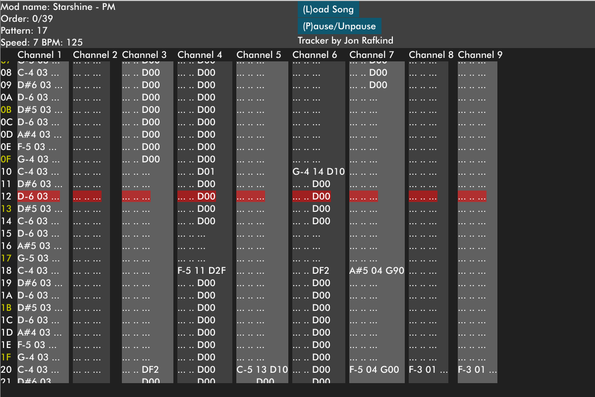

# About

A mod/s3m tracker written in Golang and Ebiten



# Online demo

https://kazzmir.itch.io/tracker

# Run

```
 $ go run ./tracker somefile.s3m
```

Or render the file to a wav output
```
 $ go run ./tracker -wav output.wav somefile.s3m
```

Playback and WAV rendering default to 48 kHz. Pass `-rate 44100` to use
44.1 kHz instead.

## MOD playback comparison

With `t1/intro.mod` available locally and FFmpeg built with `libopenmpt`, run:

```
go test ./mod -run TestIntroAgainstFFplay -v
```

This compares the entire stereo render with FFmpeg's libopenmpt decoder (the
same decoder ffplay uses), checking timing and waveform agreement without
requiring byte-identical PCM. The test skips if the fixture or decoder is absent.

# Resources:

* https://modarchive.org/index.php - archive of mod/s3m files
* https://github.com/a740g/QB64-MOD-Player/blob/main/docs/FS3MDOC.TXT - technical information about s3m files
* https://github.com/a740g/QB64-MOD-Player/blob/main/docs/FMODDOC.TXT - technical information about mod files
* https://wiki.linuxaudio.org/apps/categories/mod_trackers_and_players - other trackers
